# Beringin Smart

> **Sistem Informasi & Portal Pengaduan Sarana Prasarana Sekolah**  
> *SMK Negeri 1 Beringin • Kompetensi Keahlian Pengembangan Perangkat Lunak dan Gim (PPLG)*  
> Pengembang: **Rizky Alfianno** (XI PPLG)

[](https://ionicframework.com/)
[](https://laravel.com/)
[](https://www.typescriptlang.org/)
[](https://kemnaker.go.id/)

---

## 📌 Tentang Proyek

**Beringin Smart** adalah aplikasi web dan mobile responsif yang dirancang untuk memfasilitasi pelaporan dan penanganan kendala sarana prasarana di lingkungan sekolah. Sistem ini menghubungkan siswa sebagai pelapor dengan tim sarana prasarana sekolah agar setiap fasilitas yang rusak atau membutuhkan perbaikan dapat tercatat, dipantau, dan diselesaikan secara cepat dan transparan.

Proyek ini dikembangkan mengacu pada standar kompetensi keahlian **SKKNI No. 282 Tahun 2016** bidang pemrograman perangkat lunak.

---

## ⚡ Fitur Utama

- **Autentikasi & Otorisasi Pengguna:** Login aman berbasis token Bearer dengan Laravel Sanctum serta pembagian hak akses (*Role: Siswa & Petugas Sarpras*).
- **Dashboard Statistik:** Ringkasan jumlah tiket pengaduan secara real-time (Total Laporan, Menunggu, dan Selesai).
- **Formulir Pengaduan Sarpras:** Penginputan laporan kendala fasilitas lengkap dengan nama pelapor, lokasi/ruangan, kategori fasilitas, dan deskripsi masalah.
- **Daftar Tiket Real-Time:** Menampilkan feed pengaduan yang dilengkapi fitur pencarian cepat (*live search*) dan filter kategori (Fasilitas Kelas, Laboratorium, Lingkungan).
- **Halaman Rincian Tiket:** Informasi detail setiap laporan beserta status penanganan terkini.
- **Pembaruan Status (Khusus Petugas):** Otorisasi penutupan tiket (*Tandai Selesai*) dengan validasi ketat di tingkat server.
- **Tampilan Bersih & Responsif:** Desain modern, rapi, dan adaptif untuk perangkat mobile maupun layar desktop.

---

## 📁 Struktur Direktori

```
Beringin-Smart/
├── Beringin-Smart/                     # Frontend (Ionic 8 + React + TypeScript + Vite)
│   ├── src/
│   │   ├── pages/                      # Login.tsx, Home.tsx, Detail.tsx
│   │   ├── context/                    # LaporanContext.tsx (State Management)
│   │   ├── services/                   # api.ts (Axios + Sanctum Bearer Token)
│   │   ├── theme/                      # variables.css
│   │   └── types/                      # laporan.ts
│   └── package.json
│
├── beringin-backend/                   # Backend API (Laravel 12 + Laravel Sanctum)
│   ├── app/
│   │   ├── Http/Controllers/           # AuthController.php, LaporanController.php
│   │   └── Models/                     # User.php, Laporan.php
│   ├── database/
│   │   ├── migrations/                 # Migrasi skema database
│   │   └── seeders/DatabaseSeeder.php  # Seeder data pengguna awal
│   ├── routes/api.php                  # Endpoint API & Middleware Sanctum
│   └── config/cors.php                 # Konfigurasi CORS
└── README.md
```

---

## 🚀 Panduan Kloning & Menjalankan Aplikasi

### 1. Kloning Repository

Buka terminal dan jalankan perintah berikut:
```bash
git clone https://github.com/Sekiyyyyy/beringin-smart.git
cd beringin-smart
```

---

### 2. Setup Backend API (`beringin-backend`)

Buka terminal di root proyek, lalu ikuti langkah-langkah ini:
```bash
# 1. Masuk ke folder backend
cd beringin-backend

# 2. Pasang dependensi PHP / Laravel
composer install

# 3. Salin file environment
cp .env.example .env
# (Untuk pengguna Windows Command Prompt gunakan: copy .env.example .env)

# 4. Generate application key
php artisan key:generate

# 5. Jalankan migrasi dan isi database awal (Seeder)
php artisan migrate:fresh --seed

# 6. Jalankan server API backend
php artisan serve --port=8000
```
*Server API akan aktif di:* `http://localhost:8000/api`

---

### 3. Setup Frontend Web/Mobile (`Beringin-Smart`)

Buka terminal baru di root proyek:
```bash
# 1. Masuk ke folder frontend
cd Beringin-Smart

# 2. Pasang dependensi Node.js
npm install

# 3. Jalankan server pengembang frontend
npm run dev
```
*Aplikasi web dapat langsung diakses melalui browser di:* `http://localhost:8100` atau `http://localhost:5173`

---

## 🔑 Akun Uji Coba Bawaan (Default Seeder)

| Peran (Role) | Email | Password | Hak Akses |
| :--- | :--- | :--- | :--- |
| **Petugas Sarpras** | `petugas@beringin.sch.id` | `password123` | Memantau seluruh laporan dan memperbarui status (*Tandai Selesai*). |
| **Siswa (Rizky Alfianno)** | `siswa@beringin.sch.id` | `password123` | Mengajukan tiket pengaduan sarpras dan memantau progres penanganan. |

---

## 🛡️ Keamanan & Standar Teknis

1. **Bearer Token Sanctum:** Setiap komunikasi ke endpoint backend dilindungi token autentikasi yang disertakan via interceptor Axios.
2. **Client-Side Auth Guard:** Rute `/home` dan `/detail/:id` dilindungi sehingga pengguna yang belum login akan dialihkan otomatis ke `/login`.
3. **Role Validation (Server-Side):** Aksi perubahan status pengaduan divalidasi langsung di controller backend (`403 Forbidden` jika pengguna bukan petugas).
4. **CORS Handling:** Konfigurasi CORS diatur untuk mengizinkan request dari origin frontend secara aman.

---

## 📸 Dokumentasi Tangkapan Layar (Screenshots)

Berikut adalah dokumentasi tangkapan layar antarmuka pengguna (Frontend), layanan antarmuka backend (REST API), serta bukti pengujian sistem dan validasi keamanan.

### 1. Antarmuka Frontend (User Interface)

| Tampilan Halaman Login | Dashboard Siswa & Statistik |
| :---: | :---: |
| 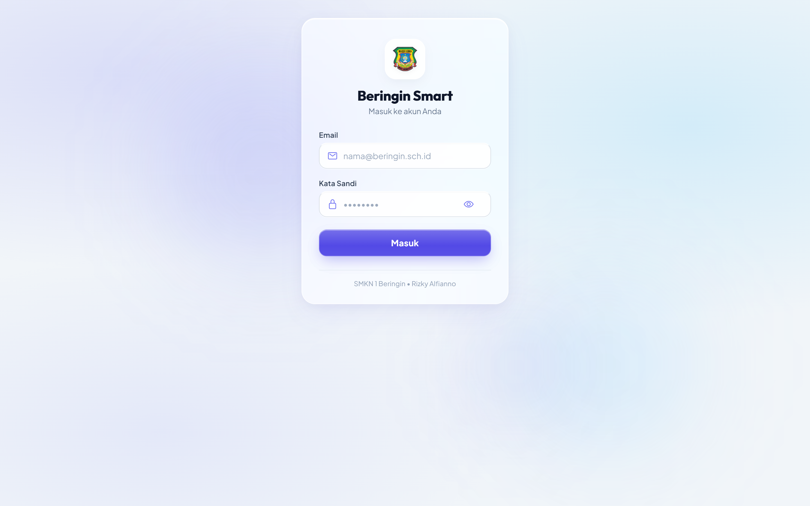 |  |
| *Antarmuka login modern dengan ambient liquid glass.* | *Ringkasan statistik tiket dan feed laporan real-time.* |

| Formulir Input Pengaduan Sarpras | Filter Kategori Fasilitas |
| :---: | :---: |
| 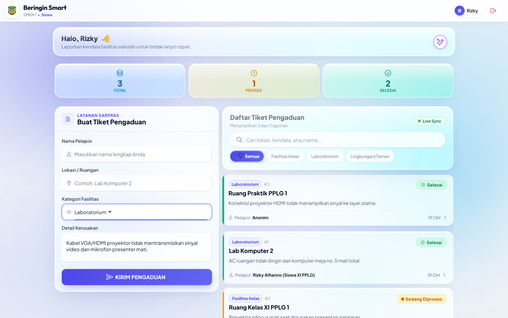 | 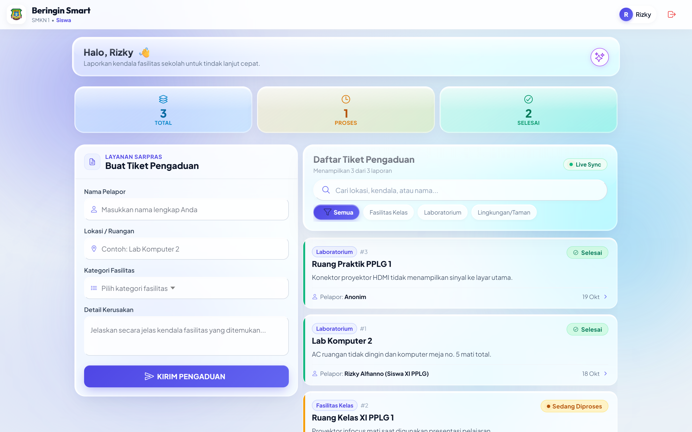 |
| *Input lokasi, kategori fasilitas, dan detail kendala.* | *Penyaringan instan (Semua, Fasilitas Kelas, Lab, Lingkungan).* |

| Dashboard Petugas Sarpras | Rincian Tiket & Aksi Petugas |
| :---: | :---: |
| 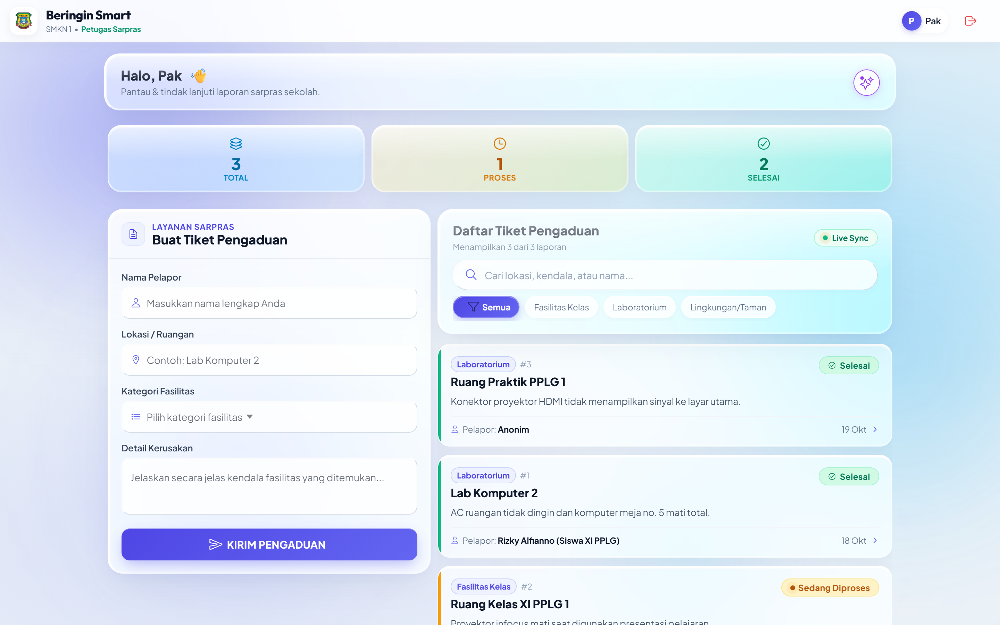 | 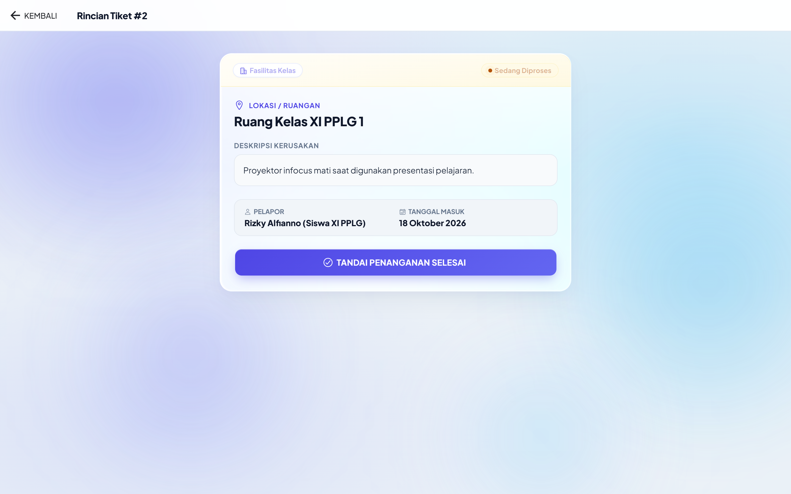 |
| *Akses otoritas petugas sarpras untuk monitoring.* | *Tombol interaktif 'Tandai Penanganan Selesai'.* |

| Tampilan Detail Siswa (Read-Only) | Tampilan Mobile Responsif (PWA) |
| :---: | :---: |
| 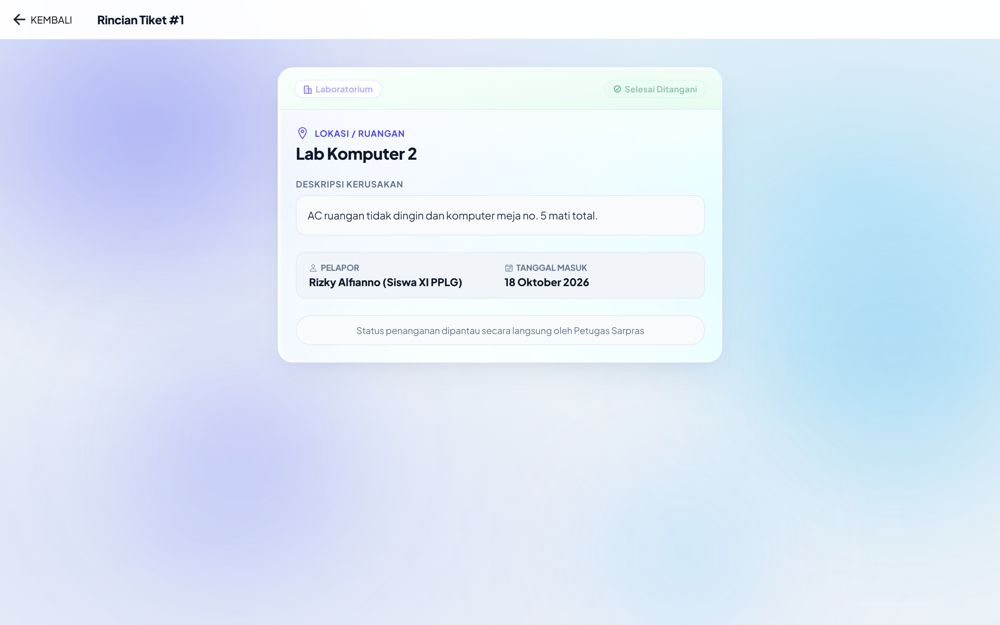 | 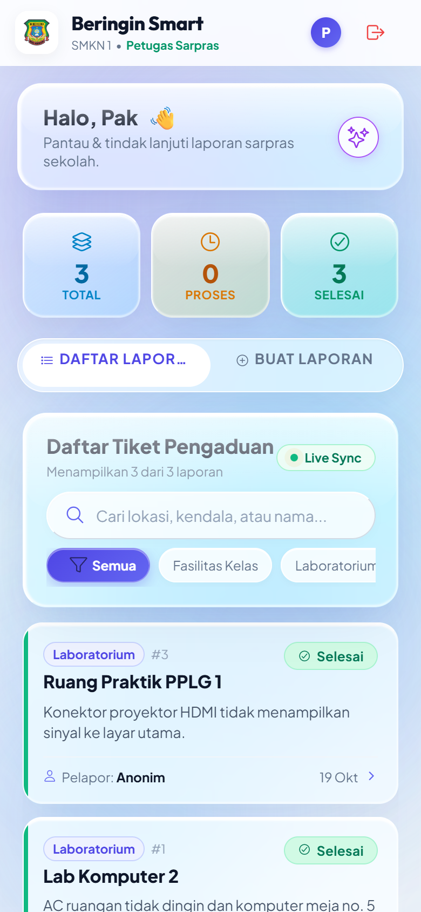 |
| *Tombol aksi disembunyikan untuk hak akses siswa.* | *Layout adaptif dan touch-friendly pada perangkat smartphone.* |

---

### 2. Backend REST API & Server Endpoints

| Daftar Endpoint API (`php artisan route:list`) | Respon Autentikasi Sanctum Bearer Token |
| :---: | :---: |
| 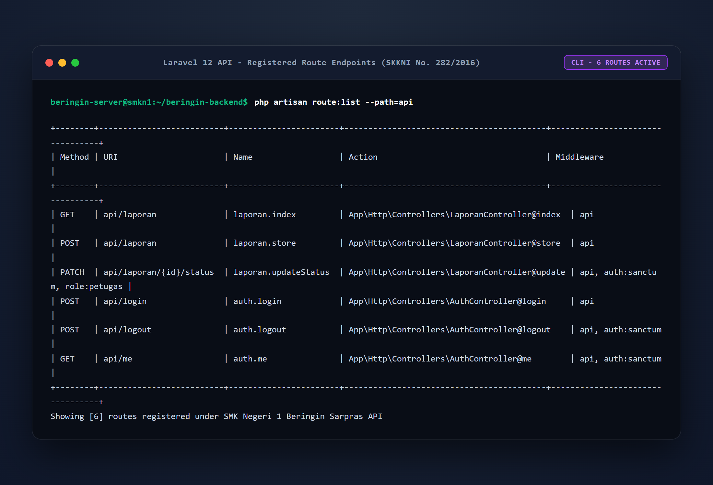 | 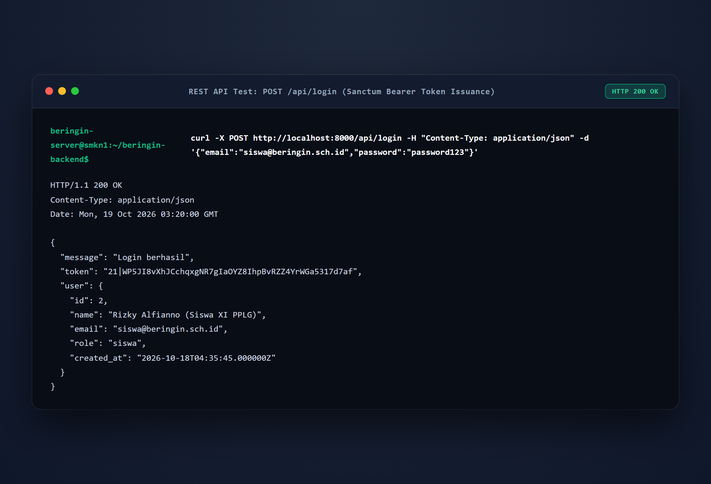 |
| *6 route endpoint terproteksi middleware Sanctum & Role Guard.* | *POST `/api/login` menghasilkan token autentikasi & info role.* |

| Respon Feed Pengaduan (GET `/api/laporan`) |
| :---: |
| 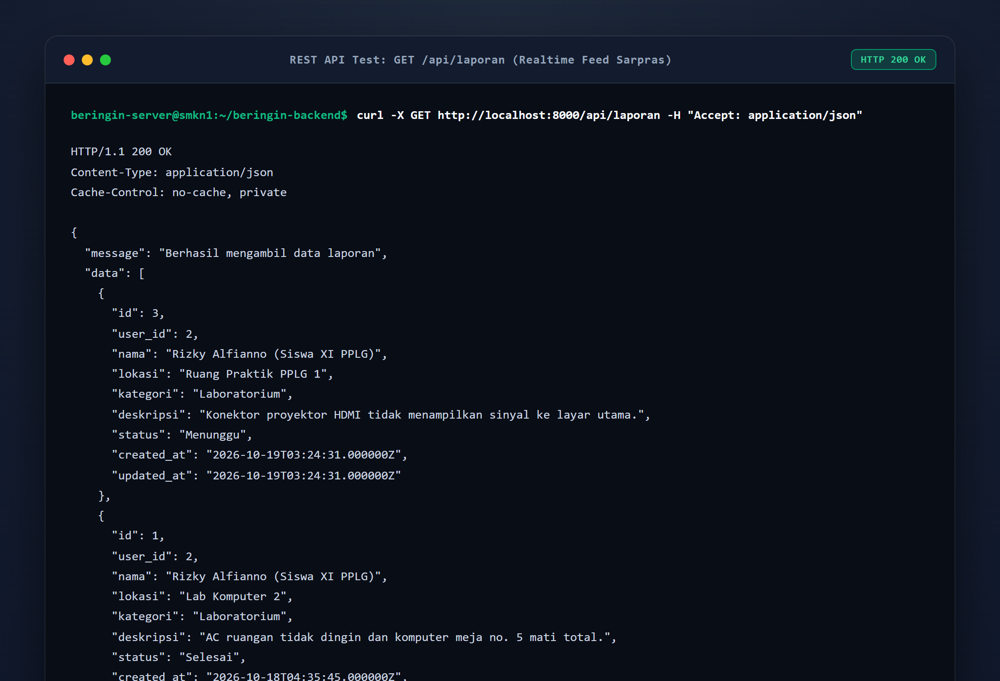 |
| *JSON array data pengaduan real-time sarana prasarana sekolah.* |

---

### 3. Matriks Hasil Pengujian Sistem & Validasi Keamanan (SKKNI No. 282/2016)

| No | Komponen Uji | Skenario Pengujian | Hasil yang Diharapkan | Hasil Aktual | Status | Bukti Screenshot |
| :---: | :--- | :--- | :--- | :--- | :---: | :---: |
| **1** | **Validasi Form Login** | Memasukkan email/password yang tidak cocok/salah. | Sistem menolak dengan HTTP 401 dan menampilkan toast peringatan. | Menampilkan toast *"Email atau password yang Anda masukkan salah."* | **PASS (100%)** | [Lihat](screenshots/02_uji_validasi_login_gagal.png) |
| **2** | **Akses Login Siswa** | Login dengan akun siswa (`siswa@beringin.sch.id`). | Mendapatkan token Sanctum, role `siswa`, dialihkan ke Beranda Siswa. | Berhasil login, menyapa *"Halo, Rizky"*, menampilkan statistik laporan siswa. | **PASS (100%)** | [Lihat](screenshots/03_uji_login_siswa_sukses.png) |
| **3** | **Akses Login Petugas** | Login dengan akun petugas (`petugas@beringin.sch.id`). | Mendapatkan token Sanctum, role `petugas`, dialihkan ke Beranda Petugas. | Berhasil login dengan otoritas sarpras untuk mengelola tiket. | **PASS (100%)** | [Lihat](screenshots/08_uji_login_petugas_sukses.png) |
| **4** | **CRUD - Create Laporan** | Siswa mengirimkan laporan kendala baru sarana prasarana. | Data tervalidasi, tersimpan ke DB (HTTP 201), dan muncul pada daftar tiket. | Tiket baru berhasil dibuat dengan status awal *"Menunggu"*. | **PASS (100%)** | [Lihat](screenshots/05_uji_crud_create_berhasil.png) |
| **5** | **CRUD - Read & Detail** | Pengguna membuka rincian tiket pengaduan. | Data tiket terbuka lengkap (ruangan, pelapor, tanggal, dan deskripsi kendala). | Halaman detail tiket menampilkan informasi akurat. | **PASS (100%)** | [Lihat](screenshots/06_detail_laporan_siswa_readonly.png) |
| **6** | **CRUD - Update Status (Petugas)** | Petugas menekan tombol *"Tandai Penanganan Selesai"*. | Status tiket diperbarui menjadi *"Selesai"* (HTTP 200) dengan badge hijau. | Status tiket berubah menjadi Selesai Ditangani & diverifikasi petugas. | **PASS (100%)** | [Lihat](screenshots/10_uji_crud_update_status_selesai.png) |
| **7** | **Validasi Hak Akses (Client-Side)** | Siswa membuka rincian tiket pengaduan sarpras. | Tombol pembaruan status tidak ditampilkan untuk pengguna role siswa. | Tombol disembunyikan, hanya menampilkan catatan pemantauan. | **PASS (100%)** | [Lihat](screenshots/06_detail_laporan_siswa_readonly.png) |
| **8** | **Validasi Keamanan (Server-Side Guard)** | Request PATCH status dikirim secara paksa menggunakan Token Siswa. | Backend menolak request dan mengembalikan kode status **HTTP 403 Forbidden**. | Server merespon: *"Akses ditolak (403 Forbidden): Hanya petugas sarpras..."*. Status DB tidak berubah. | **PASS (100%)** | [Lihat](screenshots/15_uji_validasi_keamanan_role_guard.png) |

| Bukti Validasi Keamanan Server-Side (403 Forbidden Role Guard) |
| :---: |
| 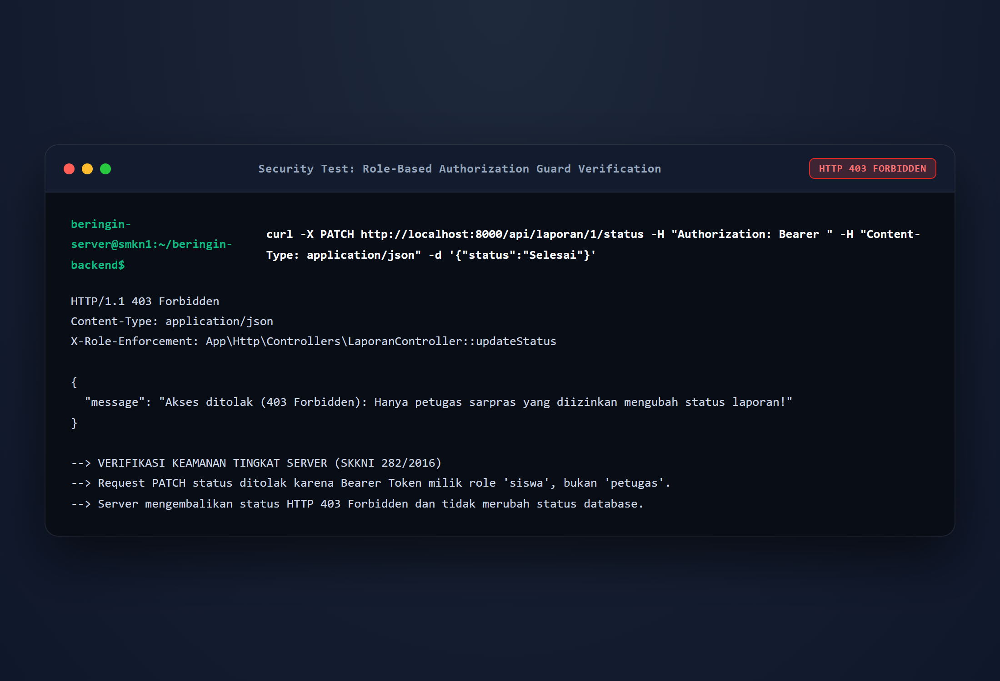 |
| *Verifikasi proteksi backend: token siswa dicekal saat mencoba mengubah status laporan.* |

---

*© SMK Negeri 1 Beringin • Modul UKK / LKPU PPLG.*